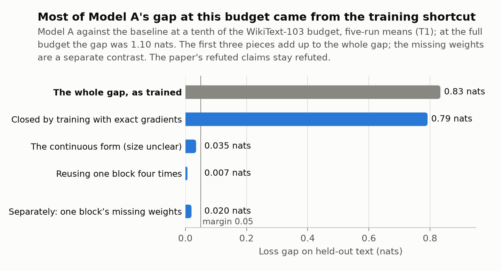
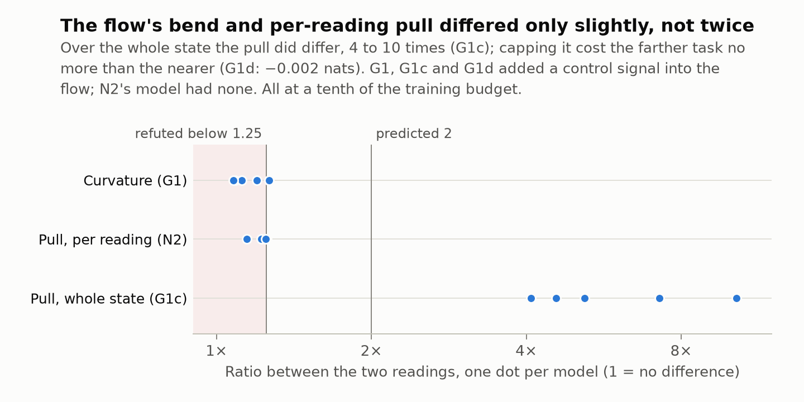
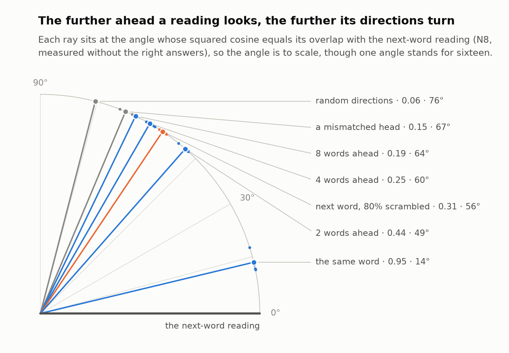
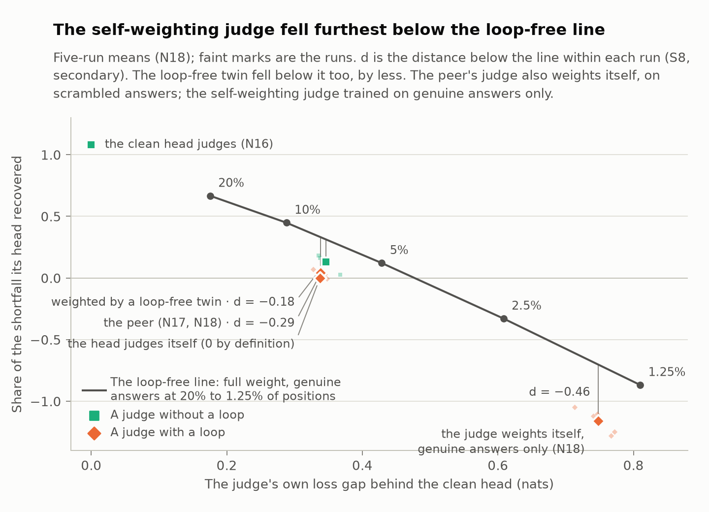
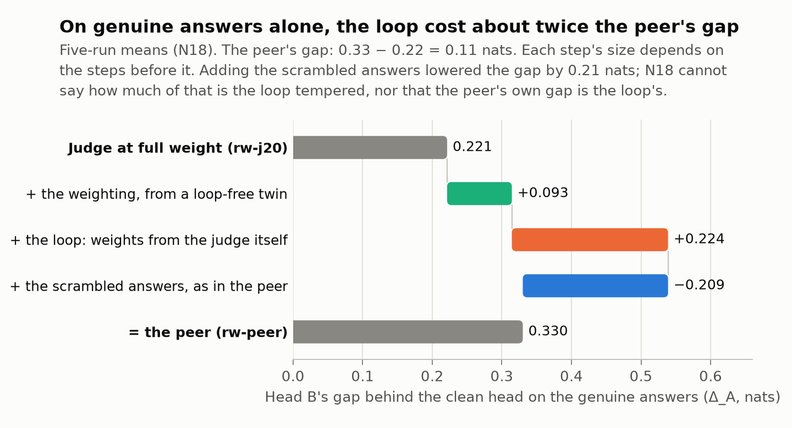
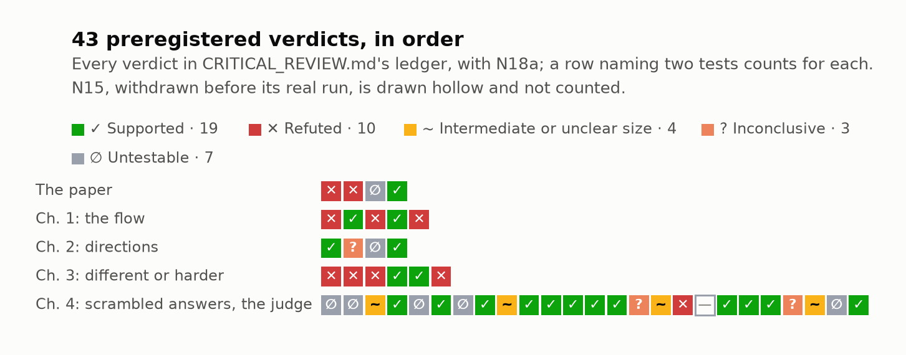
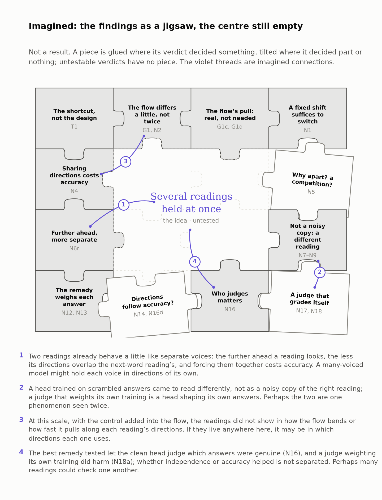

# Continuous-Depth Transformers with Learned Control Dynamics

This repository holds a January 2026 paper by Peter Jemley, the code behind it, and what happened when its claims were tested: most of them did not hold up. It then follows the idea behind the paper, a model that reads a text in several ways at once, through a series of preregistered tests. Every test's plan was written down and approved before it ran, together with the result that would count against it.

## Status, October 2026: where things stand

**What the paper proposed.** In a small transformer, two middle layers are replaced by a continuous block, a neural ordinary differential equation (ODE). Instead of passing through a fixed number of layers, each word's internal representation flows smoothly through "depth", along a field the model learns, and a small control signal u steers the flow. The studies below call the paper's main model Model A. The paper claimed that u could steer the output toward positive or negative sentiment, assigning 98% and 88% probability to the target word on the one prompt steering was trained on, at the same speed as an ordinary transformer, with a learned scale α (alpha) settling at 0.065, and with the two sentiments occupying geometrically distinct regions of the flow, shown by how hard the solver had to work.

**What an audit of the paper's own materials found.**
- The steering target labelled " good" is GPT-2 token 220, the tokenizer's code for a single space. " good" is token 922.
- The test of whether the model depends on its numerical solver, the method that computes the flow, was presented as new but had been published by Ott et al. (2020).
- The reported α of 0.065 appears in no saved output.
- The solver, probe and latency results come from a second model, not Model A: an ODE block without attention, trained for 50 steps on random tokens (the solver and probe results) or not trained at all (latency). The paper describes this second model's design in its architecture section and presents all results as one model's.

**What the preregistered replications found.** Loss is measured in nats. A difference of 0.05 nats is about a 5% change in how uncertain the model is about the next word, and 1.10 nats is about three times as uncertain.
- **WikiText-2, 8 seeds** ([results](experiments/wikitext2-replication/RESULTS.md)):
  - loss slightly worse than an ordinary transformer of the same size in all 8 seeds, but within the margin for "comparable" (+0.03 nats);
  - α settled near 0.17, not 0.065;
  - with the corrected target, token 922, steering held in only 5 of 8 seeds;
  - the extra solver effort offered as evidence of distinct regions appeared in 2 of 8;
  - the model was 7–11% slower, not as fast;
  - three claims held: the loss was comparable, the trained model behaved as a continuous ODE under more accurate solvers, and the probe result across depth was as claimed.
- **WikiText-103, a dataset about fifty times larger, trained on the full budget, 6 seeds** ([results](experiments/wikitext103-training/RESULTS.md)): Model A was worse than the ordinary transformer by 1.10 nats (95% interval [0.97, 1.23]), and it did not behave as a continuous ODE under more accurate solvers.

**Why it fell short** ([T1](experiments/too-linear-conjecture/T1_NOTE.md)). The block was trained with a memory-saving shortcut for computing its learning signal, the adjoint method. At a tenth of the training budget, where Model A trailed the ordinary transformer by 0.83 nats, training with the shortcut accounted for about 95% of the gap (0.79 nats). Trained with exact gradients, the model was 0.04 nats behind at that budget. So, at that budget, most of the loss gap came from how the model was trained, not from its design. T1 does not explain the latency or steering results, and the model has not been trained with exact gradients on the full budget.

### In pictures

Drawn by [`make_figures.py`](experiments/simultaneity-conjecture/make_figures.py): the first five from the saved records, with every plotted value by run in [`FIGURE_DATA.md`](experiments/simultaneity-conjecture/figures/FIGURE_DATA.md), and the sixth from the ledger in [`CRITICAL_REVIEW.md`](experiments/simultaneity-conjecture/CRITICAL_REVIEW.md). The tests behind them are described in the next section and in their notes; N18, the latest, is in [`N18_NOTE.md`](experiments/simultaneity-conjecture/N18_NOTE.md). The last figure is imagined: a picture of how the findings might fit together, not a result.

<picture>
  <source media="(prefers-color-scheme: dark)" srcset="experiments/simultaneity-conjecture/figures/shortcut_gap_dark.png">
  
</picture>

<picture>
  <source media="(prefers-color-scheme: dark)" srcset="experiments/simultaneity-conjecture/figures/flow_ratios_dark.png">
  
</picture>

<picture>
  <source media="(prefers-color-scheme: dark)" srcset="experiments/simultaneity-conjecture/figures/angle_fan_dark.png">
  
</picture>

<picture>
  <source media="(prefers-color-scheme: dark)" srcset="experiments/simultaneity-conjecture/figures/judges_and_the_line_dark.png">
  
</picture>

<picture>
  <source media="(prefers-color-scheme: dark)" srcset="experiments/simultaneity-conjecture/figures/n18_steps_dark.png">
  
</picture>

<picture>
  <source media="(prefers-color-scheme: dark)" srcset="experiments/simultaneity-conjecture/figures/ledger_dark.png">
  
</picture>

<picture>
  <source media="(prefers-color-scheme: dark)" srcset="experiments/simultaneity-conjecture/figures/imagined_jigsaw_dark.png">
  
</picture>

## What the later tests found

The project's own aim, the author's, goes beyond the paper. When we listen to music we follow several voices at once; a reader likewise holds characters, arguments and tone together while the words arrive one at a time. The question is whether a model can hold its readings of a text that way, and whether continuous dynamics like the paper's block help it to. The tests in [`experiments/simultaneity-conjecture/`](experiments/simultaneity-conjecture/) start small: they ask how one model holds two readings at once, such as predicting the next word and the word after it, as a stand-in for the many strands a reader follows. They used the paper's Model A, trained with exact gradients on WikiText-103 at a tenth of the full budget with one learning rate: about 30 million parameters, or 23 to 43 million with two reading heads. Most of that is the tables that map words to vectors and back: in the base model, 25.7 of 30.5 million. The plan, the decision rules and the result that would count against each claim were fixed in advance. The readings tested are close relatives, words one to eight places ahead. What has survived testing so far:

- **The continuous dynamics did not carry the readings, at this scale.** The control signal does change how strongly the flow draws nearby states together (G1c), but the model did not need that (G1d). Switching between two readings needed only a fixed shift of the state (N1), and two readings held at once did not get different paces in the flow (N2). A test that would give the dynamics a fairer chance, control that multiplies parts of the flow instead of adding to it (N3), was planned and not run.
- **Two readings held at once use partly different directions in the model's internal state, and forcing them through the same 64 of the state's 256 directions costs accuracy** (N4). The restriction was applied at the model's final readout, not inside the continuous block. Whether the cost is a competition for directions was not settled (N5).
- **The further ahead a reading looks, the less it shares directions with the next-word reading** (N6r, N8). But a reading that is the next word with most of its training answers scrambled also shares little (N7), so how much two readings share does not simply measure how different they are. The measure itself recognises a reading and its ideal noisy copy as the same (N9).
- **A reading trained on mostly scrambled answers learns something different, not a noisy copy of the right reading** (N9). Here 80% of its training answers were replaced by words drawn at random by frequency. That finding came out of N7's scrambled-answer head and became its own line of tests (N10–N16):
  - a readout that can represent the right blend of genuine answer and random word keeps most of what the reading predicts (N12);
  - its advantage lies in how it trains: it weighs each answer by its own estimate that the answer is genuine (N13);
  - along the axis of scrambled answers, N14's numbers favoured the reading that the directions a head uses follow its accuracy, though N14's primary rule returned inconclusive;
  - what still held it back was whose estimate does the weighing: when the clean reading's head judged the answers instead of the head itself, it did as well as a head given only the genuine answers (N16). Whether that judge helps by being independent, more accurate or sharper is not yet separated.

  N12's readout is a known method from learning with noisy labels, forward correction (Patrini et al., 2017); here it was told the true scrambling rate, and a head that must estimate it is untested. N16's judge is a diagnostic, not a method: it needs a clean head, which a real noisy-label problem does not have. N17 asked whether what mattered was the judge's accuracy or the loop of a head judging answers by its own predictions. Interpolated between two judges with no loop, a judge as accurate as the head itself would recover a third of the shortfall (some effect, size unclear; what makes up that third is not separated), and a peer judge of the same accuracy that judged itself, as in co-teaching (Han et al., 2018), recovered almost none (secondary). On what these methods do to the directions a reading uses, the results so far are intermediate or inconclusive (N12, N14, N16).

**The conjecture itself is untested.** No test has yet built the model it is about, one with separate, interacting continuous strands, and compared it with a matched ordinary transformer (V2 in [`CONJECTURE.md`](experiments/simultaneity-conjecture/CONJECTURE.md)) or with its own coupling switched off (V3).

## Who did what

The January 2026 paper is Peter Jemley's. The audit, the replications and the tests under [`experiments/`](experiments/) were designed, run and written up by Claude, an AI model made by Anthropic, working with the author, who approved every plan before it ran. Where those documents say "I", the writer is Claude.

## Start here

1. [`experiments/simultaneity-conjecture/PLAIN_SUMMARY.md`](experiments/simultaneity-conjecture/PLAIN_SUMMARY.md): the whole story in plain language.
2. [`experiments/simultaneity-conjecture/CRITICAL_REVIEW.md`](experiments/simultaneity-conjecture/CRITICAL_REVIEW.md): a ledger of every main claim tested, what it forbade and its verdict, and an account of where the method fell short.
3. [`experiments/too-linear-conjecture/T1_NOTE.md`](experiments/too-linear-conjecture/T1_NOTE.md): why the paper's model fell short.
4. [`experiments/simultaneity-conjecture/README.md`](experiments/simultaneity-conjecture/README.md): an index of the tests, with links to each one's note.

## Repository structure

```
├── README.md
├── LICENSE
├── model.py                                                # The paper's second model, used by the two notebooks below (not Model A)
├── pinned_data.py                                          # Offline, checksum-verified data loading
├── data/                                                   # Pinned GPT-2 tokenizer and WikiText-2 (see data/README.md)
├── scripts/fetch_wikitext2.py                              # One-time fetch that pins WikiText-2
├── experiments/
│   ├── wikitext2-replication/                              # Preregistered replication of the paper's experiments
│   │   ├── PREREGISTRATION.md                              # The plan, fixed before any run
│   │   ├── RESULTS.md                                      # The verdicts
│   │   ├── KNOWN_LIMITATIONS.md                            # Limitations of the original experiments
│   │   ├── paper_model.py                                  # Model A, restored from the original notebook
│   │   └── results/                                        # One JSON record per run
│   ├── wikitext103-training/                               # The same model trained on WikiText-103 at the full budget
│   ├── too-linear-conjecture/                              # Why the model fell short: the author asked whether the design was "too linear"; T1 traced the gap to the training shortcut
│   └── simultaneity-conjecture/                            # The tests of several readings at once (see its README.md)
├── colab/                                                  # Runs GPU jobs on Colab (see colab/README.md)
├── figures/                                                # The paper's figures
├── PAPER.md                                                # The January 2026 paper, unchanged, with a status note
├── continuous_depth_transformer_falsification_test.ipynb   # The paper's solver test and linear probes
├── continuous_depth_transformer_efficiency_benchmark.ipynb # The paper's latency benchmark
├── continuous_depth_transformers_experiments.ipynb         # A January 30 replacement for the original experiments notebook, which is in git history (6b65d64)
├── README_LATEX.md                                         # An earlier version of this README, with LaTeX formulas
├── MATH_EXPLAINER.md                                       # The architecture's mathematics (its experimental claims are obsolete)
├── PLAIN_LANGUAGE_EXPLAINER.md                             # Obsolete: presents the paper's results as validated
├── DEVELOPMENT_NOTES.md                                    # Historical: the reasoning behind the paper
└── AUDIO_TTS_RELEVANCE.md                                  # Obsolete: rests on the steering result
```

## Using the code

### Installation

```bash
pip install torch torchdiffeq datasets tiktoken
```

### Quick Start

`model.py` defines the paper's second model: an ODE block without attention, with the control signal concatenated onto the state, which in January was trained only on random tokens. The falsification and benchmark notebooks import it, and download it automatically when opened in Colab. Model A, behind the paper's training and steering results and used by every replication and later test, is [`experiments/wikitext2-replication/paper_model.py`](experiments/wikitext2-replication/paper_model.py), restored verbatim from the original notebook.

```python
import torch
from model import HybridTransformer, DEFAULT_CONFIG

# Six layers, with the ODE block in place of layers 2-3
model = HybridTransformer(DEFAULT_CONFIG)

batch_size = 2
input_ids = torch.randint(0, DEFAULT_CONFIG['vocab_size'], (batch_size, DEFAULT_CONFIG['seq_len']))

# Control signal u: the paper claimed it steers sentiment after training; the replication found that unreliable
control = torch.zeros(batch_size, DEFAULT_CONFIG['control_dim'])
control[:, 0] = 1.0

logits = model(input_ids, control)                              # Fixed 4-step Euler solver, as in training
logits_adaptive = model(input_ids, control, use_adaptive=True)  # Adaptive Dopri5 solver
```

## The original paper, January 2026 (superseded)

> Everything in this section is the paper's own account as written in January 2026, kept unchanged as the record of what was claimed. Notes marked *October 2026* say where testing found otherwise; the status section at the top of this page gives the evidence.

📄 **[Read the full paper](PAPER.md)** | 📓 **[Falsification Test](continuous_depth_transformer_falsification_test.ipynb)** | ⚡ **[Efficiency Benchmark](continuous_depth_transformer_efficiency_benchmark.ipynb)**

> **Continuous-Depth Transformers with Learned Control Dynamics**  
> Peter Jemley  
> January 2026

### Abstract

We present a hybrid transformer architecture that replaces discrete middle layers with a continuous-depth Neural Ordinary Differential Equation (ODE) block, enabling inference-time control over generation attributes via a learned steering signal. The control signal `u` steers the model's output through a continuous manifold of semantic states, achieving 98%/88% accuracy for positive/negative sentiment control with **latency parity** compared to standard transformers.

> *October 2026:* the steering target " good" was GPT-2 token 220, a space. With the corrected target, token 922, steering held in 5 of 8 replication seeds, and the model was 7–11% slower, not at parity.

### Key Results

*As claimed in January 2026, with what testing found.*

| Experiment | Result claimed | What testing found |
|------------|----------------|--------------------|
| Gradient Stability | Zero exploding/vanishing gradients | Untestable in the replication: the paper's detector flagged nothing even on a run made deliberately unstable |
| Semantic Steering | 98%/88% accuracy (positive/negative) | The " good" target was token 220, a space; with the corrected target, steering held in 5 of 8 seeds |
| Solver Invariance Test | 0.068% trajectory divergence (proves true continuity) | The test is Ott et al.'s (2020); the original result came from the second model, trained for 50 steps on random tokens. Model A passed it in all 8 replication seeds; trained on WikiText-103 at the full budget, it failed |
| Efficiency | **Latency parity** (-2.4% overhead) | 7–11% slower |
| Solver Probing | Two distinct dynamical regimes revealed | In 2 of 8 seeds |

### Architecture

The hybrid architecture uses a "sandwich" design:

```
Input → [Discrete Layers 0-1] → [ODE Block] → [Discrete Layers 4-5] → Output
                                     ↑
                              Control Signal u
```

The ODE block replaces layers 2-3 with continuous dynamics:

**LaTeX:** `dH/dτ = α · F_θ(H, τ, u)`

**Plain text:** `dH/dtau = alpha * F_theta(H, tau, u)`

where:
- `H(τ)` (`H(tau)`) is the hidden state at continuous depth τ ∈ [0, 1] (tau in [0, 1])
- `F_θ` (`F_theta`) is a learned vector field (MLP-based)
- `u` is a low-dimensional control signal
- `α` (`alpha`) is a learned output scale (initialized to 0.1, converges to ~0.065) for stability

> *October 2026:* α settled near 0.17 in all 8 replication seeds, and grew to between 1.0 and 2.1 on WikiText-103; the value 0.065 appears in no saved output. The design described here, a vector field without attention with u concatenated onto the state, is the second model's, which `model.py` defines. Model A, behind the paper's training and steering results, has attention in its ODE block and adds u to the state (`experiments/wikitext2-replication/paper_model.py`).

### The paper's experiments

Run the experiments in Google Colab:

| Notebook | Description |
|----------|-------------|
| [](https://colab.research.google.com/github/PeterJemley/Continuous-Depth-Transformers-with-Learned-Control-Dynamics/blob/main/continuous_depth_transformer_falsification_test.ipynb) | **Falsification Test**: Solver Invariance, α convergence, Linear Probes |
| [](https://colab.research.google.com/github/PeterJemley/Continuous-Depth-Transformers-with-Learned-Control-Dynamics/blob/main/continuous_depth_transformer_efficiency_benchmark.ipynb) | **Efficiency Benchmark**: Latency comparison (Baseline vs Hybrid) |

#### Experiment 1: Gradient Flow Validation

Verifies stable gradient propagation through the ODE block. The learned scalar α converged from 0.1 to 0.065, indicating the model prefers a conservative, stable update regime.

> *October 2026:* the value 0.065 appears in no saved output; α settled near 0.17 in the replication. Gradient stability could not be tested: the paper's detector flagged nothing even on a run made deliberately unstable.


#### Experiment 2: Semantic Steering

The "Hybrid Unfreeze" method trains only the ODE block to learn control semantics:

| Control Signal | P(good) | P(bad) | Result |
|----------------|---------|--------|--------|
| +1.0 (Positive) | **98.0%** | 0.2% | ✓ |
| -1.0 (Negative) | 0.2% | **88.1%** | ✓ |
| 0.0 (Neutral) | 91.4% | 3.3% | Natural bias |

**Dynamics of Resistance:** The asymmetry (98% vs 88%) reflects the model's intrinsic positive bias. Positive steering is *cooperative* (working with the natural flow), while negative steering is *adversarial* (fighting the 91.4% prior toward "good"). The 88% success rate for negative sentiment represents a greater dynamical intervention.

> *October 2026:* the " good" target is GPT-2 token 220, which is a space, so the 91.4% "prior toward good" was a preference for a space. The neutral setting u = 0 was never trained, so the "dynamics of resistance" reading has no basis; with the corrected target, neutral u favoured " good" in 6 of 8 seeds, where at least 7 were required. Steering held on the training prompt in 5 of 8 replication seeds.

#### Experiment 3: Solver Invariance Test (Methodological Contribution)

We propose a "Popperian" falsification test to verify true continuity: compare trajectories from the fixed Euler solver (used in training) against a high-precision adaptive solver (Dopri5).

**Result:** 0.068% trajectory divergence—proving the model learned an intrinsic continuous vector field rather than overfitting to discretization artifacts.

> *October 2026:* this test was published earlier by Ott et al. (2020), and this result came from the second model, trained for 50 steps on random tokens. Model A passed the test in all 8 WikiText-2 replication seeds; trained on WikiText-103 at the full budget, it did not.


#### Solver Probing: Geometric Structure

The adaptive ODE solver reveals that positive and negative sentiment occupy geometrically distinct regions of the learned dynamics:


**Key finding**: The negative sentiment regime requires 43% more solver steps (NFE=20 vs NFE=14), indicating higher curvature. This is the geometric manifestation of "Dynamics of Resistance"—the vector field must exhibit greater curvature to divert trajectories against the natural positive prior.

> *October 2026:* the extra solver effort for negative steering appeared in 2 of 8 replication seeds.

**Global Bias Interpretation:** Linear probes trained on hidden states at intermediate depths (τ = 0, 0.5, 0.67, 1.0) showed flat sentiment separability—no "decision point" spike at τ ≈ 0.67. This confirms the control signal tilts the entire landscape from τ = 0, rather than triggering a late discrete decision.

> *October 2026:* the original probe result came from the second model; the replication found probe selectivity flat across depth in Model A, as claimed.

### Core Components

> *October 2026:* the first excerpt below is from `model.py`, the second model; the Hybrid Unfreeze and solver-probing excerpts come from Model A's code.

#### ControlledVectorField and ContinuousDepthBlock

The vector field concatenates the control signal onto the hidden state, and the block integrates it from τ = 0 to τ = 1 (excerpt from `model.py`):

```python
class ControlledVectorField(nn.Module):
    def forward(self, t, h, u):
        # Broadcast u across the sequence and concatenate it onto the hidden state
        u_expanded = u.unsqueeze(1).expand(-1, h.shape[1], -1)
        return self.net(torch.cat([h, u_expanded], dim=-1))  # F_θ(H, τ, u)

class ContinuousDepthBlock(nn.Module):
    def forward(self, h, u, use_adaptive=False):
        def func(t, x):
            return self.alpha * self.vector_field(t, x, u)   # α · F_θ
        # Fixed Euler steps in training; Dopri5 when use_adaptive=True
        ...
```

#### Hybrid Unfreeze Training

The key to learning meaningful control:

```python
# Phase 1: Warmup (all parameters)
# Phase 2: Intermediate (control_embed only)
# Phase 3: Hybrid Unfreeze (ODE block only)
for p in model.parameters():
    p.requires_grad = False
for p in model.ode_block.parameters():
    p.requires_grad = True
```

#### Solver Probing

Use adaptive solvers as interpretability instruments:

```python
class InstrumentedODEFunc(ODEFunc):
    def forward(self, t, x):
        self.nfe += 1  # Count function evaluations
        return super().forward(t, x)
```

## Citation

```bibtex
@article{jemley2026continuous,
  title={Continuous-Depth Transformers with Learned Control Dynamics},
  author={Jemley, Peter},
  year={2026}
}
```

## License

MIT; see [`LICENSE`](LICENSE). The files in [`data/`](data/) keep their own licenses: WikiText under Creative Commons Attribution-ShareAlike 3.0, and OpenAI's GPT-2 tokenizer files under the modified MIT license in `data/gpt2/LICENSE` (see [`data/README.md`](data/README.md)).

## Acknowledgments

This work builds on Neural ODEs (Chen et al., 2018) and activation steering (Turner et al., 2023).
