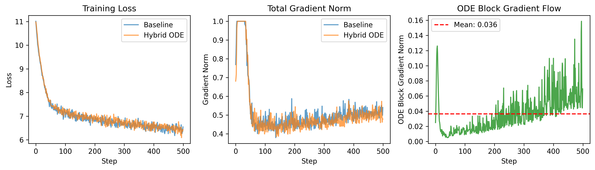
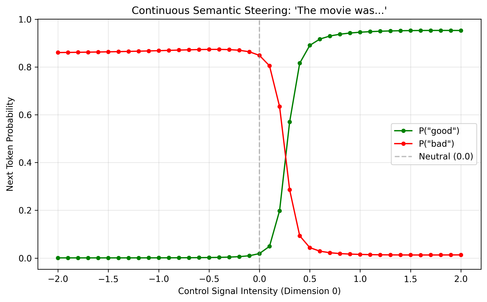
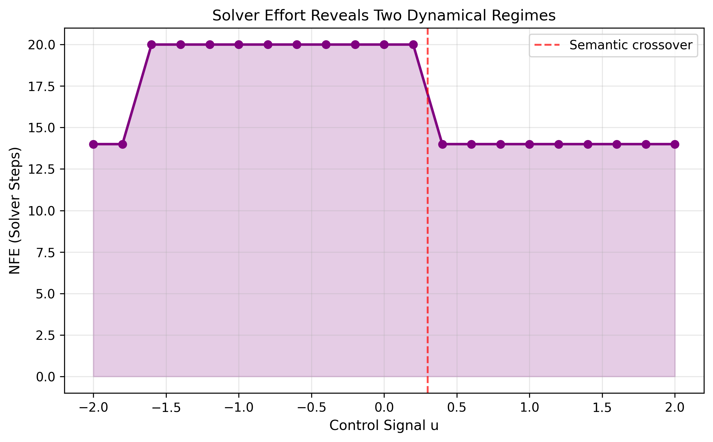

# Continuous-Depth Transformers with Learned Control Dynamics

This repository contains the implementation and experiments for:

> **Continuous-Depth Transformers with Learned Control Dynamics**  
> Peter Jemley  
> January 2026

📄 **[Read the full paper](PAPER.md)** | 📓 **[Falsification Test](continuous_depth_transformer_falsification_test.ipynb)** | ⚡ **[Efficiency Benchmark](continuous_depth_transformer_efficiency_benchmark.ipynb)**

> **Status, October 2026: the paper's headline results did not hold up.** The paper, the three notebooks and the "Key Results" below are kept unchanged as the record of what was claimed in January 2026. They are not current findings.
>
> **What the audit found.**
> - The steering target labelled " good" is GPT-2 token 220, which is a space.
> - The solver test presented as new was published earlier by Ott et al. (2020).
> - The reported α of 0.065 appears in no saved output.
> - The solver, probe and latency results come from a different model, trained for 50 steps on random tokens or not trained at all.
>
> **What the preregistered studies found.**
> - **WikiText-2 replication, 8 seeds** ([results](experiments/wikitext2-replication/RESULTS.md)):
>   - loss comparable to the baseline (+0.03 nats);
>   - α settled near 0.17, not 0.065;
>   - steering held in only 5 of 8 seeds;
>   - the solver-effort "regimes" appeared in 2 of 8;
>   - the model was 7–11% slower, not at parity.
> - **WikiText-103, properly trained, 6 seeds** ([results](experiments/wikitext103-training/RESULTS.md)): Model A was worse than the baseline by 1.10 nats (95% interval [0.97, 1.23]), and it did not behave as a continuous ODE under more accurate solvers.
> - **Why** ([T1](experiments/too-linear-conjecture/T1_NOTE.md)): training with adjoint gradients caused about 95% of that gap. Trained with exact gradients, the model was 0.04 nats behind the baseline at 10% of the budget.
>
> **Where the work went next.** The project's own aim is a model that holds several readings of a text at once, like voices in music. That is tested in [`experiments/simultaneity-conjecture/`](experiments/simultaneity-conjecture/). Start with the plain-language summary, [`PLAIN_SUMMARY.md`](experiments/simultaneity-conjecture/PLAIN_SUMMARY.md). A critical review of all the work, in the manner of Popper and Deutsch, including where the method fell short, is in [`CRITICAL_REVIEW.md`](experiments/simultaneity-conjecture/CRITICAL_REVIEW.md). Known limitations of the original experiments are in [`KNOWN_LIMITATIONS.md`](experiments/wikitext2-replication/KNOWN_LIMITATIONS.md).

## Abstract

We present a hybrid transformer architecture that replaces discrete middle layers with a continuous-depth Neural Ordinary Differential Equation (ODE) block, enabling inference-time control over generation attributes via a learned steering signal. The control signal `u` steers the model's output through a continuous manifold of semantic states, achieving 98%/88% accuracy for positive/negative sentiment control with **latency parity** compared to standard transformers.

## Key Results

*As claimed in January 2026. Most did not hold up when tested; see the status note above.*

| Experiment | Result |
|------------|--------|
| Gradient Stability | Zero exploding/vanishing gradients |
| Semantic Steering | 98%/88% accuracy (positive/negative) |
| Solver Invariance Test | 0.068% trajectory divergence (proves true continuity) |
| Efficiency | **Latency parity** (-2.4% overhead) |
| Solver Probing | Two distinct dynamical regimes revealed |

## Architecture

The hybrid architecture uses a "sandwich" design:

```
Input → [Discrete Layers 0-1] → [ODE Block] → [Discrete Layers 4-5] → Output
                                     ↑
                              Control Signal u
```

The ODE block replaces layers 2-3 with continuous dynamics:

**LaTeX:** `dH/dτ = α · F_θ(H, τ, u)`

**Plain text:** `dH/dtau = alpha * F_theta(H, tau, u)`

where:
- `H(τ)` (`H(tau)`) is the hidden state at continuous depth τ ∈ [0, 1] (tau in [0, 1])
- `F_θ` (`F_theta`) is a learned vector field (MLP-based)
- `u` is a low-dimensional control signal
- `α` (`alpha`) is a learned output scale (initialized to 0.1, converges to ~0.065) for stability

## Installation

```bash
pip install torch torchdiffeq datasets tiktoken
```

## Quick Start

`model.py` holds the one shared definition of the model. The falsification and benchmark notebooks import it, and download it automatically when opened in Colab.

```python
import torch
from model import HybridTransformer, DEFAULT_CONFIG

# Six layers, with the ODE block in place of layers 2-3
model = HybridTransformer(DEFAULT_CONFIG)

batch_size = 2
input_ids = torch.randint(0, DEFAULT_CONFIG['vocab_size'], (batch_size, DEFAULT_CONFIG['seq_len']))

# Control signal u (it steers the output once the model has been trained)
control = torch.zeros(batch_size, DEFAULT_CONFIG['control_dim'])
control[:, 0] = 1.0

logits = model(input_ids, control)                              # Fixed 4-step Euler solver, as in training
logits_adaptive = model(input_ids, control, use_adaptive=True)  # Adaptive Dopri5 solver
```

## Experiments

Run the experiments in Google Colab:

| Notebook | Description |
|----------|-------------|
| [](https://colab.research.google.com/github/PeterJemley/Continuous-Depth-Transformers-with-Learned-Control-Dynamics/blob/main/continuous_depth_transformer_falsification_test.ipynb) | **Falsification Test**: Solver Invariance, α convergence, Linear Probes |
| [](https://colab.research.google.com/github/PeterJemley/Continuous-Depth-Transformers-with-Learned-Control-Dynamics/blob/main/continuous_depth_transformer_efficiency_benchmark.ipynb) | **Efficiency Benchmark**: Latency comparison (Baseline vs Hybrid) |

### Experiment 1: Gradient Flow Validation

Verifies stable gradient propagation through the ODE block. The learned scalar α converged from 0.1 to 0.065, indicating the model prefers a conservative, stable update regime.



### Experiment 2: Semantic Steering

The "Hybrid Unfreeze" method trains only the ODE block to learn control semantics:

| Control Signal | P(good) | P(bad) | Result |
|----------------|---------|--------|--------|
| +1.0 (Positive) | **98.0%** | 0.2% | ✓ |
| -1.0 (Negative) | 0.2% | **88.1%** | ✓ |
| 0.0 (Neutral) | 91.4% | 3.3% | Natural bias |

**Dynamics of Resistance:** The asymmetry (98% vs 88%) reflects the model's intrinsic positive bias. Positive steering is *cooperative* (working with the natural flow), while negative steering is *adversarial* (fighting the 91.4% prior toward "good"). The 88% success rate for negative sentiment represents a greater dynamical intervention.

### Experiment 3: Solver Invariance Test (Methodological Contribution)

We propose a "Popperian" falsification test to verify true continuity: compare trajectories from the fixed Euler solver (used in training) against a high-precision adaptive solver (Dopri5).

**Result:** 0.068% trajectory divergence—proving the model learned an intrinsic continuous vector field rather than overfitting to discretization artifacts.



### Solver Probing: Geometric Structure

The adaptive ODE solver reveals that positive and negative sentiment occupy geometrically distinct regions of the learned dynamics:



**Key finding**: The negative sentiment regime requires 43% more solver steps (NFE=20 vs NFE=14), indicating higher curvature. This is the geometric manifestation of "Dynamics of Resistance"—the vector field must exhibit greater curvature to divert trajectories against the natural positive prior.

**Global Bias Interpretation:** Linear probes trained on hidden states at intermediate depths (τ = 0, 0.5, 0.67, 1.0) showed flat sentiment separability—no "decision point" spike at τ ≈ 0.67. This confirms the control signal tilts the entire landscape from τ = 0, rather than triggering a late discrete decision.

## Repository Structure

```
├── model.py                                                # Shared model definition
├── pinned_data.py                                          # Offline, checksum-verified data loading
├── data/                                                   # Pinned GPT-2 tokenizer and WikiText-2 (see data/README.md)
├── scripts/fetch_wikitext2.py                              # One-time fetch that pins WikiText-2
├── experiments/
│   ├── wikitext2-replication/                              # Preregistered replication of the paper's experiments
│   │   ├── PREREGISTRATION.md                              # The plan, fixed before any run
│   │   ├── KNOWN_LIMITATIONS.md                            # Limitations of the original experiments
│   │   └── results/                                        # One JSON record per run
│   └── wikitext103-training/                               # The same model properly trained on WikiText-103
│       ├── PREREGISTRATION.md
│       └── study.py
├── colab/                                                  # Runs GPU jobs on Colab (see colab/README.md)
├── continuous_depth_transformer_falsification_test.ipynb   # Solver Invariance Test & Linear Probes
├── continuous_depth_transformer_efficiency_benchmark.ipynb # Latency Benchmark
├── continuous_depth_transformers_experiments.ipynb         # Early prototype with its own model definition
├── PAPER.md                                                # Paper (Markdown)
├── figures/
│   ├── fig1_gradient_flow.png
│   ├── fig2_continuous_steering.png
│   ├── fig3_control_topology.png
│   └── fig4_continuous_limit.png
├── README.md
├── README_LATEX.md
├── MATH_EXPLAINER.md
├── PLAIN_LANGUAGE_EXPLAINER.md
├── DEVELOPMENT_NOTES.md
└── AUDIO_TTS_RELEVANCE.md
```

## Core Components

### ControlledVectorField and ContinuousDepthBlock

The vector field concatenates the control signal onto the hidden state, and the block integrates it from τ = 0 to τ = 1 (excerpt from `model.py`):

```python
class ControlledVectorField(nn.Module):
    def forward(self, t, h, u):
        # Broadcast u across the sequence and concatenate it onto the hidden state
        u_expanded = u.unsqueeze(1).expand(-1, h.shape[1], -1)
        return self.net(torch.cat([h, u_expanded], dim=-1))  # F_θ(H, τ, u)

class ContinuousDepthBlock(nn.Module):
    def forward(self, h, u, use_adaptive=False):
        def func(t, x):
            return self.alpha * self.vector_field(t, x, u)   # α · F_θ
        # Fixed Euler steps in training; Dopri5 when use_adaptive=True
        ...
```

### Hybrid Unfreeze Training

The key to learning meaningful control:

```python
# Phase 1: Warmup (all parameters)
# Phase 2: Intermediate (control_embed only)
# Phase 3: Hybrid Unfreeze (ODE block only)
for p in model.parameters():
    p.requires_grad = False
for p in model.ode_block.parameters():
    p.requires_grad = True
```

### Solver Probing

Use adaptive solvers as interpretability instruments:

```python
class InstrumentedODEFunc(ODEFunc):
    def forward(self, t, x):
        self.nfe += 1  # Count function evaluations
        return super().forward(t, x)
```

## Citation

```bibtex
@article{jemley2026continuous,
  title={Continuous-Depth Transformers with Learned Control Dynamics},
  author={Jemley, Peter},
  year={2026}
}
```

## License

MIT

## Acknowledgments

This work builds on Neural ODEs (Chen et al., 2018) and activation steering (Turner et al., 2023).
